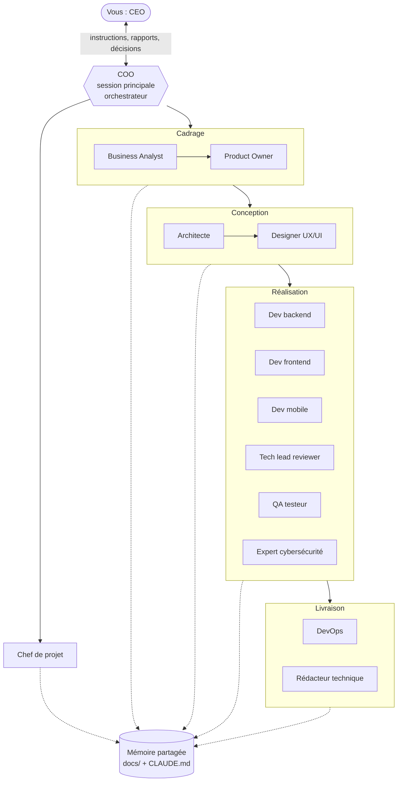
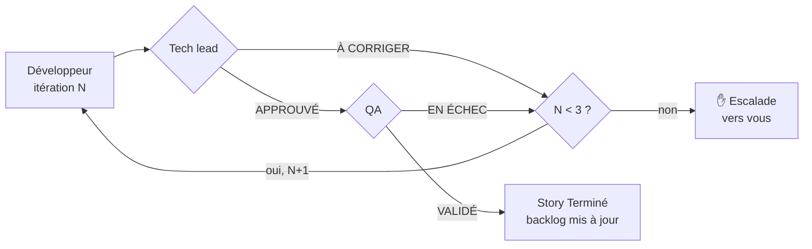

# devteam : une équipe de développement virtuelle pour Claude Code

`devteam` est un plugin Claude Code qui simule une entreprise de développement logiciel.
Chaque rôle d'une vraie équipe devient un **subagent spécialisé**. Des **commandes slash**
orchestrent le cycle de vie d'un projet : cadrage, conception, sprints, revue, tests,
déploiement, documentation et suivi.

> Version 0.3.0, auteur : Peter ATATI

---

## Le concept



**Principe clé** : un subagent ne peut pas lancer un autre subagent. Les commandes slash,
exécutées par la session principale, jouent donc le rôle de l'orchestrateur. Elles appellent
les agents **un par un**, et les agents se transmettent le travail **uniquement par des
fichiers** dans le dépôt du projet.

### L'équipe

| # | Agent | Mission | Modèle | Outils |
|---|---|---|---|---|
| 1 | `business-analyst` | Besoin flou → `docs/specs.md` + user stories Given/When/Then | sonnet | lecture/écriture docs |
| 2 | `product-owner` | Priorisation MoSCoW, MVP, découpage en sprints | sonnet | lecture/écriture docs |
| 3 | `architecte` | Stack, structure, modèle de données, API, ADR, `CLAUDE.md` | opus | docs + recherche web |
| 4 | `ux-ui-designer` | Parcours, écrans, maquettes HTML/CSS dans `docs/maquettes/` | sonnet | lecture/écriture docs |
| 5 | `dev-backend` | API, BD, logique métier + tests unitaires | sonnet | code + Bash |
| 6 | `dev-frontend` | Interfaces web + tests | sonnet | code + Bash |
| 7 | `dev-mobile` | Écrans mobiles (Flutter par défaut) + tests | sonnet | code + Bash |
| 8 | `tech-lead-reviewer` | Revue OWASP/qualité → `docs/reviews/<story>.md`, verdict | opus | **lecture seule** + écriture du rapport |
| 9 | `qa-testeur` | Tests unitaires, intégration, e2e → `docs/qa/<story>.md` | sonnet | code de test + Bash |
| 10 | `expert-cybersecurite` | Audit OWASP, secrets, dépendances, conteneurs, RGPD → `docs/securite/<cible>.md` | opus | **lecture seule** + scanners installés + écriture du rapport |
| 11 | `devops` | Docker, docker-compose, `.gitlab-ci.yml`, déploiement | sonnet | code + Bash |
| 12 | `redacteur-technique` | README, `docs/api.md`, CHANGELOG | haiku | lecture/écriture docs |
| 13 | `chef-de-projet` | Avancement, risques → `docs/suivi.md` | haiku | lecture + écriture du suivi |
| | `coo` | **Agent principal** : interlocuteur du CEO, délègue, contrôle, arbitre, rapports et journal des décisions | modèle de la session | Agent + lecture, écriture de `docs/rapports-coo/` et `docs/decisions-ceo.md` |

### Les commandes

| Commande | Ce qu'elle fait |
|---|---|
| `/devteam:nouveau-projet <besoin>` | BA → PO → ✋ validation → Architecte → ✋ validation → Designer |
| `/devteam:sprint [n]` | Pour chaque story du sprint : dev → revue → QA (3 itérations max, puis escalade) |
| `/devteam:story <id>` | La même boucle pour une seule story |
| `/devteam:review [fichiers\|branche]` | Tech lead seul |
| `/devteam:tests [id]` | QA seul |
| `/devteam:securite [id\|branche\|tout]` | Expert cybersécurité seul (proposé automatiquement avant un déploiement staging ou production) |
| `/devteam:deploy [env]` | DevOps, avec confirmation action par action avant tout geste irréversible |
| `/devteam:doc [périmètre]` | Rédacteur technique |
| `/devteam:statut` | Chef de projet |
| `/devteam:coo [instruction]` | La session endosse le rôle de COO (mode CEO) |
| `/devteam:aide [commande]` | Aide intégrée |

### Les skills (procédures réutilisables)

**Standards de l'équipe** (priorités : simplicité, lisibilité, code générique et réutilisable, structure claire) :

| Skill | Contenu | Agents qui doivent l'appliquer |
|---|---|---|
| `clean-code` | KISS, YAGNI, règle de trois pour le générique, nommage, fonctions courtes, erreurs typées, checklist en 10 points | dev-backend, dev-frontend, dev-mobile (avant de coder), architecte, qa-testeur, devops |
| `clean-architecture` | règle de dépendance, structure `domain/application/infrastructure/presentation/shared`, ports et adaptateurs, proportionnalité, exemple complet | dev-backend, dev-frontend, dev-mobile (avant de créer un fichier), architecte |
| `code-review` | grille fondée sur les deux précédentes, format fixe Bloquant / À améliorer / Suggestion, sur-ingénierie et duplication | tech-lead-reviewer, expert-cybersecurite |
| `style-equipe` | interdiction des tirets longs et des tics d'écriture « IA », interfaces sans « look IA », organisation stricte des livrables | les 13 agents |

**Procédures métier** : `redaction-user-story` (BA) · `code-review-checklist` (OWASP, tech lead et sécurité) · `plan-de-test` (QA) · `conventions-git` (développeurs) · `adr` (architecte)

Chaque agent a une section « Skills obligatoires » dans son prompt. Elle lui indique quelle skill lire,
et à quel moment, via son chemin `${CLAUDE_PLUGIN_ROOT}/skills/<nom>/SKILL.md`.

### La boucle de réalisation d'une story



### La mémoire partagée (dans le dépôt cible)

```
mon-projet/
├── CLAUDE.md              # stack, commandes, conventions (lu par tous les agents)
└── docs/
    ├── specs.md           # cahier des charges            ← business-analyst
    ├── backlog.md         # stories, priorités, statuts   ← BA, PO, devs
    ├── architecture.md    # architecture, données, API     ← architecte
    ├── adr/               # décisions d'architecture       ← architecte
    ├── maquettes/         # maquettes HTML/CSS             ← ux-ui-designer
    ├── reviews/           # rapports de revue              ← tech-lead-reviewer
    ├── qa/                # rapports de test               ← qa-testeur
    ├── securite/          # audits de sécurité             ← expert-cybersecurite
    ├── rapports-coo/      # un rapport par compte rendu    ← COO
    ├── decisions-ceo.md   # journal des décisions du CEO   ← COO
    └── suivi.md           # avancement et risques          ← chef-de-projet
```

Les modèles de ces fichiers se trouvent dans [`templates/`](templates/).

### Points de validation humaine ✋

1. Après les specs et le backlog (`nouveau-projet`).
2. Après l'architecture (`nouveau-projet`).
3. Avant de lancer un sprint (`sprint`).
4. Après 3 itérations sans succès sur une story (`sprint`, `story`).
5. Avant **chaque** action irréversible ou distante (`deploy`) : push, déploiement, migration de production.

Aucun agent ne pousse de code ni ne déploie sans votre accord explicite.

---

## Mode CEO : parler à un seul interlocuteur, le COO

Vous jouez le **CEO**. Vous ne parlez qu'au **COO** (directeur des opérations), en langage
naturel, sans connaître aucune commande. Le COO est la **session principale** de Claude Code,
et non un subagent, puisqu'un subagent ne peut pas en lancer d'autres. Il reformule
votre demande, pose au plus 3 questions de cadrage et propose un plan. Ensuite, il délègue
aux 13 agents dans le bon ordre et contrôle leurs livrables. Il ne vous interrompt que pour
une décision.

### Activer le COO

La documentation de Claude Code ne prévoit pas qu'un plugin impose un rôle à la session
principale. Le mécanisme officiel est le réglage `agent` (ou l'option `--agent`), qui fait
tourner la session principale avec le prompt, les outils et le modèle d'un agent.

| Usage | Comment |
|---|---|
| **Projet en mode CEO par défaut** (recommandé) | Dans le projet cible, `.claude/settings.json` : `{ "agent": "devteam:coo" }` |
| Une seule session | `claude --agent devteam:coo` |
| Dans une session déjà ouverte | `/devteam:coo` (la session endosse le rôle jusqu'à la fin de la conversation) |

Placez le réglage dans le `.claude/settings.json` **du projet** plutôt que dans
`~/.claude/settings.json`. Sinon, toutes vos sessions, dans tous vos projets, démarreront en COO.
L'option `--agent` l'emporte toujours sur le réglage, par exemple
`claude --agent devteam:dev-backend` pour une session ponctuelle.

### Ce que le COO vous remonte, et seulement cela
1. Le choix de la stack et les décisions d'architecture coûteuses à changer.
2. La validation des specs et du périmètre du MVP.
3. Les compromis délai, qualité et périmètre, par exemple une story bloquée après 3 itérations.
4. Le déploiement en production.
5. Les dépenses.
6. Les actions irréversibles ou externes : `git push`, fusion dans `main`, migration, suppression.

### Rapport au format fixe
Chaque compte rendu suit le modèle [`templates/rapport-coo.md`](templates/rapport-coo.md).
Il est affiché, puis enregistré dans `docs/rapports-coo/AAAA-MM-JJ-HHMM.md`. Il se termine par
un bloc `DÉCISION REQUISE` numéroté quand le COO attend une validation. Chacune de vos
décisions est consignée dans `docs/decisions-ceo.md`, que le COO relit avant chaque mission.

### Exemple de dialogue

> **CEO** : Je veux une petite API de gestion de tâches pour mon équipe. Fais-moi le point et dis-moi ce que tu proposes.

> **COO** :
> ### Rapport COO : 2026-11-14 15:00
> **Mission** : donner à votre équipe un service central pour créer, attribuer et suivre ses tâches.
> - ✅ **Fait** : état des lieux (dépôt vide), journal des décisions créé.
> - 🔄 **En cours** : aucun point.
> - ⛔ **Bloqué** : aucun point.
> - ❓ **Décisions attendues du CEO**
>   1. Périmètre : API seule ou avec écran web ? Recommandation : API seule, un écran pourra venir ensuite.
>   2. Accès : un compte par membre ? Recommandation : oui, pour savoir qui fait quoi.
>   3. Budget : une dépense à ce stade ? Recommandation : non, la V1 tourne sur un serveur interne.
> - ⚠️ **Risques** : périmètre qui gonfle (impact moyen), parade : MVP court validé avant tout développement.
> - ➡️ **Prochaine étape proposée** : specs et user stories par le Business Analyst, après vos réponses.
>
> #### DÉCISION REQUISE
> 1. Périmètre : « 1 : oui » pour une API seule. Recommandation : API seule.
> 2. Accès : « 2 : oui ». Recommandation : oui.
> 3. Budget : « 3 : oui » pour aucune dépense. Recommandation : aucune dépense.

> **CEO** : 1 oui, 2 oui, 3 oui. Vas-y.

> **COO** : C'est noté (décisions D-001 à D-003). Je lance le Business Analyst, puis le
> Product Owner. Je reviens vers vous pour valider les specs et le MVP.
>
> *Le COO fait travailler `business-analyst`, puis `product-owner`, sans interrompre le CEO.*
>
> ### Rapport COO : 2026-11-14 15:40
> - ✅ **Fait** : specs (`docs/specs.md`), 9 user stories, MVP de 5 stories en 2 sprints.
> - …
> #### DÉCISION REQUISE
> 1. Valider les specs et le MVP. Recommandation : oui, le périmètre tient en 2 sprints.

> **CEO** : Validé. Et prends la stack que tu juges la plus simple à maintenir.

> **COO** : Décision D-004 consignée. Je fais travailler l'architecte et vous présente la
> stack avec son coût de maintenance avant le premier sprint.

Les commandes `/devteam:*` restent disponibles pour les utilisateurs avancés. Si vous en tapez
une, le COO l'exécute normalement.

---

## Installation

### Prérequis
- Claude Code récent, avec la gestion des plugins (`/plugin`).
- `git`, et `bash` pour le hook. Sous Windows, Git Bash suffit (Claude Code l'utilise déjà).

### Depuis GitHub
```
/plugin marketplace add PeterATATI16/DevTeam
/plugin install devteam@devteam-marketplace
```

### Depuis GitLab (ou tout autre serveur git)
Utilisez l'URL complète du dépôt :
```
/plugin marketplace add https://gitlab.com/<groupe>/<projet>.git
/plugin install devteam@devteam-marketplace
```
En SSH : `/plugin marketplace add git@gitlab.com:<groupe>/<projet>.git`.
Pour une version figée : ajoutez `#v0.1.0` (tag) à la source.

> `devteam-marketplace` est le nom déclaré dans `.claude-plugin/marketplace.json`. Ce dépôt
> sert à la fois de marketplace et de plugin (`"source": "./"`).

### Depuis le terminal (sans session interactive)
```bash
claude plugin marketplace add PeterATATI16/DevTeam
```
```bash
claude plugin install devteam@devteam-marketplace --scope project
```

### En local, pour développer le plugin
```bash
claude --plugin-dir ./
```
ou
```bash
claude plugin validate .
```

Après l'installation, tapez `/devteam:aide`.

---

## Exemple de bout en bout : gestion des sinistres d'une compagnie d'assurance

### 1. Cadrage et conception
```
/devteam:nouveau-projet "Application de gestion des sinistres pour une compagnie
d'assurance : les assurés déclarent un sinistre auto ou habitation en ligne (web et
mobile) avec photos ; les gestionnaires instruisent les dossiers, demandent des pièces,
missionnent un expert et valident l'indemnisation ; tableau de bord des délais."
```

Déroulé :
1. **Business Analyst** : il produit `docs/specs.md`, avec les acteurs (assuré, gestionnaire, expert, responsable), les règles de gestion et les exigences RGPD. Il produit aussi `docs/backlog.md`, avec environ 15 stories, par exemple `US-004 : Déclarer un sinistre en ligne`. Il pose ses questions ouvertes, par exemple : « Les franchises sont-elles calculées par l'application ? » ou « Faut-il une intégration avec le système de contrats existant ? ».
2. **Product Owner** : il définit le MVP (déclaration, suivi du dossier, instruction par le gestionnaire) et planifie le sprint 1 (authentification, déclaration auto, liste des dossiers).
3. ✋ **Vous validez** les specs et le backlog, ou demandez des ajustements.
4. **Architecte** : il produit `docs/architecture.md`, par exemple avec NestJS, PostgreSQL, React et Flutter, un stockage S3-compatible pour les photos et une authentification OIDC. Il écrit les ADR `0001-…` à `0005-…` et le `CLAUDE.md` du projet.
5. ✋ **Vous validez** l'architecture.
6. **Designer** : il produit `docs/maquettes/` (déclaration en 4 étapes, suivi du dossier, file de travail du gestionnaire).

### 2. Réalisation
```
/devteam:sprint 1
```
Pour `US-004` :
- itération 1 : `dev-backend` implémente `POST /api/v1/sinistres`. Le tech lead rend **À CORRIGER** avec la remarque R-02 (Bloquant), une faille IDOR sur `GET /sinistres/:id`.
- itération 2 : la correction est faite et le tech lead rend **APPROUVÉ**. Le QA rend **EN ÉCHEC** sur `QA-01`, car une photo de plus de 10 Mo est acceptée.
- itération 3 : la correction est faite, le tech lead rend **APPROUVÉ** et le QA rend **VALIDÉ**. La story passe à `Terminé`.

### 3. Suivi, documentation, livraison
```
/devteam:statut
/devteam:doc
/devteam:deploy staging
```
Le DevOps prépare `Dockerfile`, `docker-compose.yml`, `.gitlab-ci.yml` et `.env.example`. Il liste les actions à confirmer, par exemple `git push` puis le déclenchement du job `deploy:staging`. Vous les validez une par une.

---

## Vérifier qu'un agent applique les standards

Depuis un dossier de test vide, lancez l'agent `dev-backend` seul :

```bash
mkdir -p /tmp/devteam-test && cd /tmp/devteam-test && git init -q
```
```bash
claude -p "Test des standards, sans rien écrire sur le disque. 1) Cite mot pour mot le point 1 de la checklist de la skill clean-code. 2) Selon clean-architecture, dans quel dossier va un adaptateur PostgreSQL ? 3) Écris en TypeScript la pagination des listes de sinistres, de contrats et d'assurés." --plugin-dir /chemin/vers/DevTeam --agent devteam:dev-backend --allowedTools=Read | tee sortie.txt
```
```bash
grep -c $'\xe2\x80\x94\|\xe2\x80\x93' sortie.txt
```

Résultat attendu :
1. La citation « J'ai cherché une brique existante dans `shared/` avant d'écrire. » prouve que la skill a été lue.
2. La réponse est `infrastructure/`, avec le port dans `domain/`.
3. Une **seule** fonction générique `paginate<T>()` dans `shared/` (règle de trois), et non trois fonctions recopiées.
4. Le `grep` final affiche `0` : aucun tiret long.

Une fois le plugin installé, remplacez `--plugin-dir …` par rien. Pour le relecteur, faites le même
test avec `--agent devteam:tech-lead-reviewer` sur un fichier volontairement sur-ingénieré.
La sortie doit suivre le format Bloquant / À améliorer / Suggestion.

---

## Maîtriser les coûts

- **Un rôle à la fois** : quand c'est suffisant, préférez `/devteam:review`, `/devteam:tests`, `/devteam:doc` ou `/devteam:statut` aux commandes complètes.
- **Story par story** : sur un gros sprint, utilisez `/devteam:story <id>` plutôt que `/devteam:sprint`, et répartissez le travail sur plusieurs sessions.
- **Modèles adaptés** : opus est réservé à l'architecte et au tech lead. Les agents de documentation et de suivi utilisent haiku. Vous pouvez changer le champ `model:` de chaque agent.
- **Échanges par fichiers** : l'orchestrateur transmet des chemins plutôt que des contenus, ce qui évite de dupliquer le contexte.
- **Itérations limitées** : la boucle s'arrête à 3 itérations et vous rend la main.
- **Cadrage court** : une description précise dès `nouveau-projet` limite les allers-retours avec le BA.

---

## Le hook qualité

`hooks/hooks.json` déclare un hook `PostToolUse` sur `Edit|Write|MultiEdit`. Il lance
[`hooks/lint-si-present.sh`](hooks/lint-si-present.sh), qui lit le chemin du fichier modifié
sur l'entrée standard (avec `jq`, sinon `python`, sinon `sed`) et fait deux contrôles.

**1. Style : tirets longs interdits.** Si le fichier (code, Markdown, HTML, CSS, YAML…)
contient un tiret cadratin ou demi-cadratin, le hook renvoie les lignes concernées à Claude
(code 2), qui doit les corriger. La skill `style-equipe` est exclue, car elle montre ces
caractères en exemple.

**2. Formatage et lint.** Hors `docs/`, `node_modules/`, `dist/`, `build/`, `vendor/` et
`.dart_tool/`, il applique l'outil **s'il est installé dans le projet ou sur la machine** :

| Fichiers | Outils (dans l'ordre) |
|---|---|
| JS/TS/Vue/Svelte/CSS/JSON/HTML | `node_modules/.bin/prettier`, `eslint --fix`, `biome` (local au projet uniquement, rien n'est téléchargé) |
| Python | `ruff format` + `ruff check --fix`, sinon `black` |
| Dart / Flutter | `dart format` |
| Go | `gofmt -w` |
| Rust | `rustfmt` |
| Kotlin | `ktlint -F` |
| Shell | `shfmt -w` |

Le hook **ne bloque jamais** : si un outil est absent ou échoue, il sort en code 0. Le code 2
d'un hook `PostToolUse` ne bloque rien non plus : l'édition reste appliquée, et Claude reçoit
le message.

Variables d'environnement :
- `DEVTEAM_HOOK_DISABLE=1` désactive le hook.
- `DEVTEAM_STYLE_CHECK=0` désactive le contrôle des tirets longs.
- `DEVTEAM_LINT_FEEDBACK=1` transmet à Claude les erreurs de lint restantes (code de sortie 2). L'édition est conservée, et Claude peut corriger.

Il est portable sous Linux, macOS et Windows (Git Bash). Les chemins Windows sont convertis avec `cygpath`.

---

## Personnaliser ou ajouter un agent

### Modifier un agent existant
Éditez `agents/<rôle>.md` :
- `description` : quand l'utiliser. L'orchestrateur et Claude s'en servent pour choisir l'agent.
- `tools` : liste minimale d'outils, selon le principe du moindre privilège.
- `model` : `haiku`, `sonnet`, `opus` ou `inherit`.
- corps : mission, entrées, livrables, format de sortie, checklist, interdits.

Exemple : pour faire du `dev-mobile` un développeur React Native, remplacez les mentions
de Flutter dans son prompt, ou fixez la technologie dans `docs/architecture.md`.

### Ajouter un agent (exemple : expert accessibilité)
1. Créez `agents/expert-accessibilite.md` :
   ```markdown
   ---
   name: expert-accessibilite
   description: "Expert accessibilité. À utiliser avant une livraison pour auditer les écrans (WCAG 2.1 AA) et produire docs/accessibilite.md."
   tools: Read, Glob, Grep, Write
   model: sonnet
   ---
   # Rôle : Expert accessibilité

   ## Skills obligatoires
   - **Pour tout livrable** : lis et applique `${CLAUDE_PLUGIN_ROOT}/skills/style-equipe/SKILL.md`.

   ## Mission …
   ## Entrées attendues …
   ## Livrables …
   ## Format de sortie …
   ## Checklist qualité …
   ## Ce que tu ne dois PAS faire …
   ```
   Mettez la `description` entre guillemets si elle contient « : ».
2. Pour l'orchestrer, ajoutez une commande `commands/accessibilite.md` qui appelle
   l'agent `devteam:expert-accessibilite`, sur le modèle de `commands/securite.md`.
3. Si besoin, ajoutez un modèle dans `templates/` et une ligne dans `commands/aide.md`.
4. Vérifiez avec `claude plugin validate .`, puis incrémentez la version dans
   `.claude-plugin/plugin.json` et `CHANGELOG.md`.

Les agents sont appelés sous la forme `devteam:<name>`.

---

## Structure du plugin

```
.
├── .claude-plugin/
│   ├── plugin.json          # manifeste du plugin
│   └── marketplace.json     # marketplace pointant vers ce dépôt
├── agents/                  # 13 subagents + le COO (agent principal)
├── commands/                # 11 commandes /devteam:*
├── skills/                  # 9 skills (SKILL.md, et references/ si besoin)
├── hooks/                   # hooks.json + lint-si-present.sh
├── templates/               # modèles de la mémoire partagée
├── README.md
└── CHANGELOG.md
```

## Feuille de route

| Phase | Contenu | Statut |
|---|---|---|
| 1 | Équipe de 13 agents, commandes, standards de code, mode CEO avec le COO, fonctionnement 100 % terminal | Livrée (0.3.0) |
| 2 | Connexion du COO à Microsoft Teams (notifications et échanges bidirectionnels via Claude Code en mode headless, sans clé API) | Prévue |

La phase 2 est préparée sans être implémentée. Le plugin ne contient aucun bridge, webhook,
bot ni serveur, et fonctionne entièrement dans le terminal Claude Code, sans clé d'API ni
service externe. Trois choix faciliteront l'intégration :
- les rapports du COO ont un format fixe (six rubriques et un bloc `DÉCISION REQUISE` numéroté),
  convertible tel quel en carte Teams ;
- chaque rapport est un fichier `docs/rapports-coo/<date-heure>.md`, donc facile à relayer ;
- chaque décision du CEO est tracée dans `docs/decisions-ceo.md`, avec un identifiant `D-xxx`
  qu'une réponse depuis Teams pourra référencer.

---

## Licence
À définir par l'auteur.
