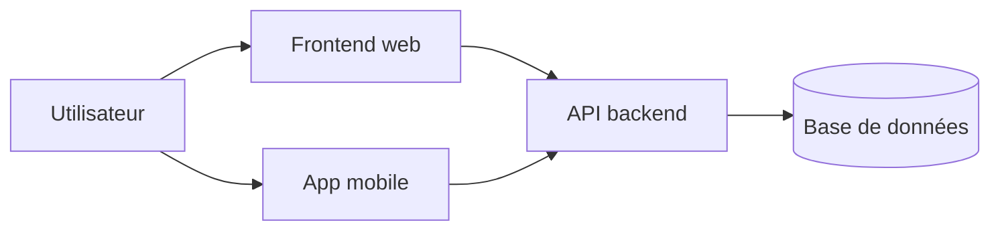
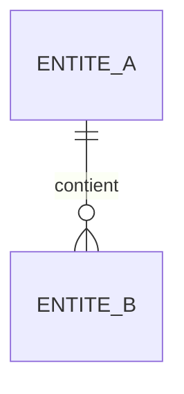

# Architecture : <Nom du projet>

> Rédigé par : architecte · Version : 0.1 · Date : AAAA-MM-JJ · Statut : Proposé | Validé

## 1. Vue d'ensemble


## 2. Stack technique
| Couche | Choix | Version | Justification | ADR |
|---|---|---|---|---|
| Backend | | | | 0001 |
| Base de données | | | | |
| Frontend | | | | |
| Mobile | | | | |
| CI/CD | GitLab CI | | | |
| Hébergement | | | | |

## 3. Structure du projet
```
.
├── backend/
├── frontend/
├── mobile/
├── docs/
└── CLAUDE.md
```

## 4. Modèle de données

| Entité | Attribut | Type | Contraintes |
|---|---|---|---|
| | | | |

## 5. API
**Authentification** : …  ·  **Format d'erreur** : `{ "code": "…", "message": "…" }`

| Méthode | Chemin | Auth | Rôle | Description | Stories |
|---|---|---|---|---|---|
| GET | /api/v1/… | Oui | | | |

Exemple :
```json
POST /api/v1/…
{ }
→ 201 { }
```

## 6. Sécurité
- Authentification / autorisation : …
- Gestion des secrets : variables d'environnement, jamais versionnées
- Données personnelles : …
- Journalisation : …

## 7. Stratégie de tests
| Niveau | Outil | Commande |
|---|---|---|
| Unitaires | | |
| Intégration | | |
| E2E | | |

## 8. Environnements
| Environnement | URL | Déploiement |
|---|---|---|
| local | http://localhost:… | docker compose up |
| staging | | manuel depuis GitLab CI |
| production | | manuel, après validation |

## 9. Décisions (ADR)
| ADR | Titre | Statut |
|---|---|---|
| 0001 | | Proposé |

## 10. Risques et dette technique
| Risque | Impact | Mitigation |
|---|---|---|
| | | |
